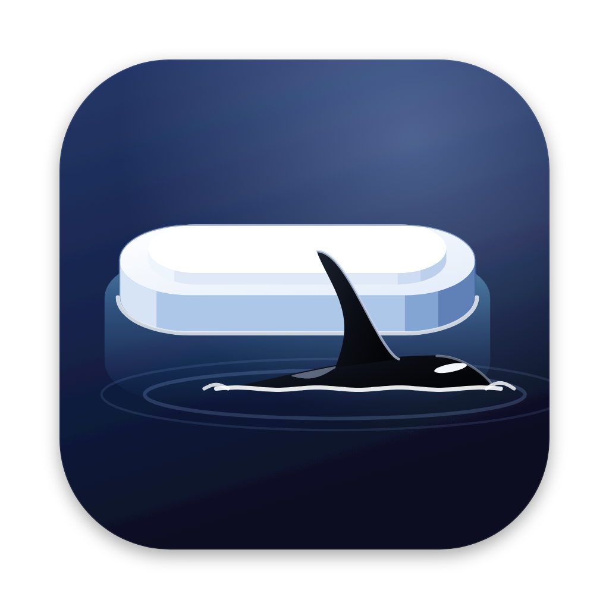
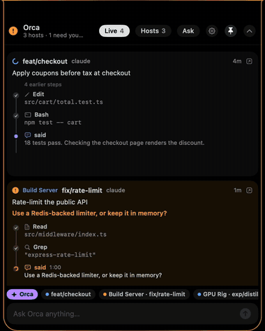
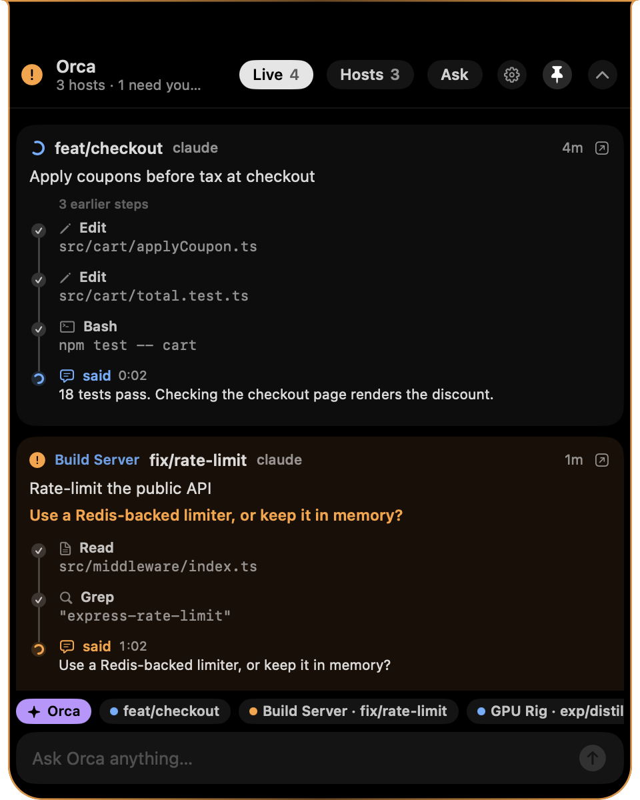
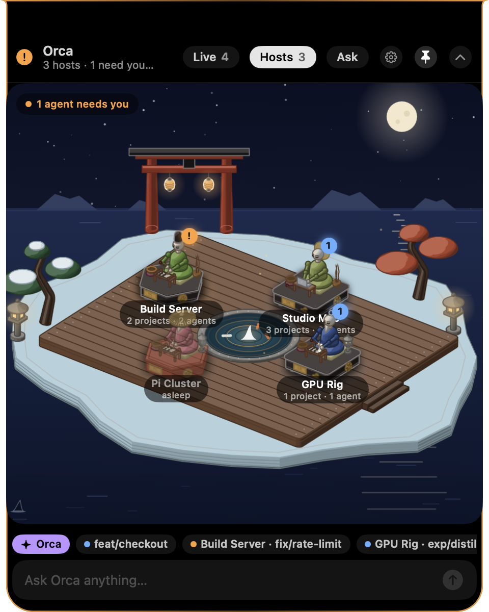
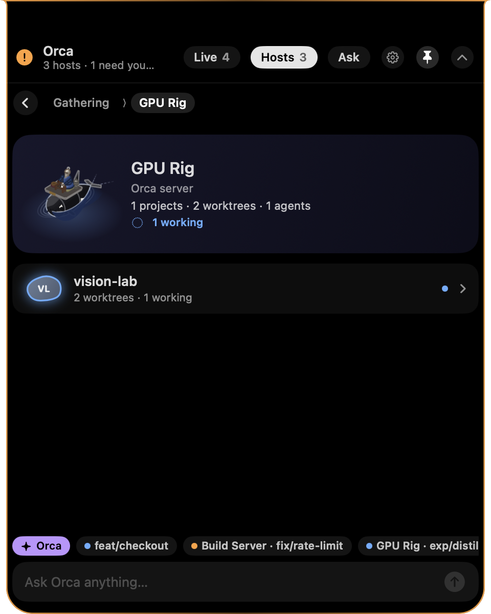
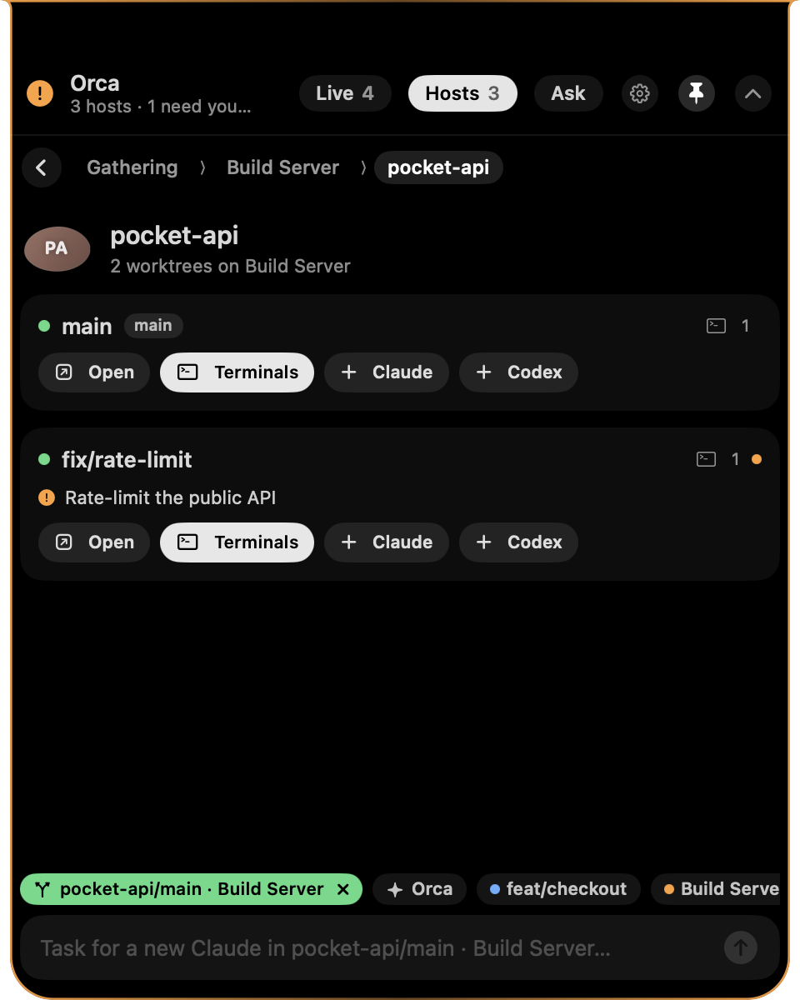

# Floe

**A Dynamic-Island overlay for [Orca](https://orca.stably.ai).** Floe sits in your Mac's notch (on Linux and
Windows, at the top centre of the screen) and shows what your Orca agents are doing on every host: live
tool-call timelines, questions waiting for an answer, and a moonlit sea before a shrine island where every
machine is a mechanical sage riding an orca. It stays out of your way, even in a full-screen game.

<p align="center">
  
  <br><a href="docs/floe.mp4">Watch the video (MP4)</a>
</p>

(An orca's favourite place: the ice floe. A floe is a floating island, and so is Floe.)

## Install

**macOS and Linux:**

```sh
curl -fsSL https://raw.githubusercontent.com/mukhayyar/floe/main/install.sh | bash
```

**Windows** (PowerShell):

```powershell
irm https://raw.githubusercontent.com/mukhayyar/floe/main/install.ps1 | iex
```

That's all. The installer:
- checks for Orca;
- installs [Bun](https://bun.sh) if you don't have it;
- downloads the latest release:
  - macOS: a universal `Floe.app` for Apple Silicon and Intel, into `~/Applications`;
  - Linux: `Floe.AppImage` (x86_64 or aarch64) into `~/.local/share/floe`, plus an entry in your apps menu;
  - Windows: `floe.exe` into `%LOCALAPPDATA%\Floe`, plus a Start menu entry;
- starts Floe, and starts it at login from then on.

You'll need Orca, and macOS 14 (Sonoma) or newer, a Linux desktop, or Windows 10/11. These are optional:
- [Claude Code](https://claude.com/claude-code), for the Ask tab.
- Google Chrome, Chromium, Brave or Edge, which draws the sages once per host (Windows always has Edge).

```sh
curl -fsSL https://raw.githubusercontent.com/mukhayyar/floe/main/install.sh | bash -s -- --uninstall    # remove it
curl -fsSL https://raw.githubusercontent.com/mukhayyar/floe/main/install.sh | bash -s -- --from-source  # build the app here
```

On Windows, remove it with `$env:FLOE_UNINSTALL=1; irm https://raw.githubusercontent.com/mukhayyar/floe/main/install.ps1 | iex`.

The Linux and Windows builds are new, so a few things differ from the Mac (see [Linux and Windows](#linux-and-windows)).

## What it does

| | |
|---|---|
|  | **Live.** Agents that need you come first, then working, then recently finished. Each one shows its tool calls as a timeline that draws itself step by step. When an agent asks a question or wants permission, its options are buttons with their descriptions: tap one, or type an answer. A question in several parts shows its tabs, and a pick-any question shows checkboxes with Back and Next. Turn on **Auto-deliver** and Floe answers some prompts itself (see Settings). |
|  | **Hosts.** Every Orca host is a karakuri sage riding an orca through the open sea, before a snowy island with a shrine and a great torii standing in the water. Each orca swims its own loop, always facing the way it goes, and riding the swell. While its agents work, it swims faster, beating its flukes and leaving a wake, and the sage writes on its scroll (or types, on this Mac). When one needs you, it swims to the front and waits there, spouting, while the sage strikes its singing bowl. When the host is offline, it drifts asleep by the island with its lantern out. |
|  | **Drill down.** Tap a sage, then a project, then a worktree: its agents and terminals (the main terminal is marked). Peek at a terminal, type into it, message an agent, start any agent installed on that host (your Orca default first), or jump to it in Orca. |
|  | **Ask Orca.** The Ask tab is a headless Claude Code session that can read your repos and drive Orca through its CLI, on any host. Pick a worktree and its pill sits above the input, so you know where a message goes. |

The collapsed pill wraps the notch like a live activity: a spinner and a count while agents work, an
orange pulse when one needs you, and a green tick when one finishes.

<p align="center"></p>

### The sages


Each host gets its own automaton, drawn as an isometric figure with the
[anatomy](https://skills.wheresryan.sh/anatomy) kit: a turned wooden doll with ball-jointed arms,
riding an orca. The host is part of Orca, so its sage rides one.
- **The orca:** one turned body with a tall dorsal fin, beating flukes, pectoral fins and white
  markings. The saddle board on its back carries the sage, its desk, its singing bowl and a lantern
  or incense.
- **Seeded per host:** the hat, the silk robe's colour, the board's shape and lacquer, the beard,
  the orca's markings and the characters it writes. Floe picks them so no two hosts look alike.
- **Name plate:** the host's initials are on a brass plate at the front of the board.

The proxy renders each sage once per host as a sprite sheet, seen from the front and from behind.
Floe swims them with Core Animation:
- **Loops:** each rider laps its own diamond across the water. Its four legs run along the
  picture's two diagonals, and the front and back views, plain and mirrored, give the four
  headings, so a rider turns at each corner and always faces the way it swims.
- **Depth:** nearer riders pass in front of farther ones, and each name tag follows its rider.
- **Swell:** every rider bobs and rocks about its waterline, at its own phase.
- **Moods:** riders swim faster while agents work. One that needs you comes to the front and
  waits, and one that's offline moors by the island.

Moonlight glints drift across the sea and fireflies over the island. All of it runs in the
render server, so it costs the app nothing per frame.

### Every agent harness

Floe shows every agent Orca runs, under its own name: Claude, Codex, OMP, Pi, Gemini, OpenCode,
Kimi, Goose, Crush, Cline, Aider and the rest of Orca's catalog. Each host offers the harnesses
installed on it. Floe reads each harness's questions and approvals off its screen and answers them
the way that harness expects:

| How it answers | Harnesses |
|---|---|
| Presses the option's digit | Claude, Codex, Gemini, OpenCode questions, Kimi, Cline questions, Qwen Code |
| Moves the cursor with ↑/↓ and checks where it landed, then Enter (Space ticks a box) | Pi, OMP, Goose, Crush questions |
| Uses the harness's own keys for button rows that show their highlight only in colour | OpenCode (Enter / Esc), Crush (`a`/`s`/`d`), Cline (`y`/`n`), Aider (`y`/`n`/`d`) |

Floe never sends Esc to answer a question. In Codex and OMP, Esc stops the whole turn.

### Built for games

Floe never takes focus when you click it. It sits above borderless and full-screen games, including
Dota 2's SDL full-screen mode, and has no hover-to-expand, so edge-panning won't open it. Over Floe
you get the normal Mac cursor instead of the game's (unless the pill is click-through, when the
game keeps its cursor because the click goes to the game). Drag it along the top edge to clear
your HUD.

### Linux and Windows

On Linux and Windows, Floe is a separate app ([`desktop/`](desktop/), built with Tauri), with the same island
and the same tabs: Live, Hosts, Ask and Settings. Some things work differently from the Mac:

- **It sits at the top centre of the screen** (on GNOME, just under the top bar). Drag it sideways
  to move it. `Alt+Space` opens it (set `hotkey` in `config.json`), and `Esc` closes it.
- **Its tray icon** has Open, Settings and Quit, where the desktop shows tray icons. GNOME needs the
  AppIndicator extension for this; without the extension there's no tray icon, but Floe works the same.
- **It starts the proxy itself.** There's no separate service: quitting Floe stops the proxy it started.
  On first run, Floe adds itself to your login items. Turn that off with "Launch at login" in Settings.
- **Linux:**
  - On a Wayland desktop it runs through XWayland, because Wayland doesn't let apps place their
    own window or keep it on top. Wayland also doesn't let apps listen for keys, so on its own
    `Alt+Space` works only while an X11 or XWayland window has focus. Make it work everywhere with a
    desktop keyboard shortcut that runs `floe --toggle`. On GNOME, Settings adds that shortcut for
    you. Because GNOME uses `Alt+Space` for its window menu, the button offers to take the key from it.
  - On GNOME with X11, `Alt+Space` reaches Floe before GNOME's window menu.
  - Transparent corners need a compositing desktop, which every current one is.
  - The AppImage needs FUSE 2. Without it, the installer unpacks it instead.
  - Floe uses Orca's own CLI (`orca-ide`) and never runs a bare `orca`, which on Ubuntu is the
    GNOME screen reader.
- **Games:** Floe stays above windowed and borderless full-screen games. Exclusive full-screen
  mode on Windows covers every overlay, so pick borderless.
- **Files:**
  - App and proxy: `~/.local/share/floe` on Linux, `%LOCALAPPDATA%\Floe` on Windows.
  - Logs: `~/.local/state/floe` on Linux, `%LOCALAPPDATA%\Floe\logs` on Windows.
  - Settings: `~/.config/floe` on every system.
- **What's been tested:**
  - Linux: the proxy and the app on an Ubuntu 24.04 desktop (X11), against a real Orca.
  - Windows, in CI:
    - the app's build and startup;
    - the installer on a fresh machine;
    - the proxy talking to a stand-in Orca over a Windows named pipe: it reads the agents and
      answers a question.

    Neither has been run against a real Orca on Windows yet.

## Use it

| | |
|---|---|
| `⌥ Space` (`Alt+Space` on Linux and Windows) | open Floe and focus the input (again, or `Esc`, to close it and hand focus back) |
| click the pill | open Floe |
| drag the pill | move it along the top edge (it snaps to the notch) |
| right-click the pill | snap to notch, click-through, border, sounds, quit |
| `open floe://hosts` | deep links: `live`, `hosts`, `ask`, `collapse`, `pin`, `unpin`, `host?id=…`, `project?host=…&key=…`, `workspace?host=…&project=…&key=…` |

**Click-through in full-screen games** (right-click menu or Settings) makes the pill ignore the
mouse while a full-screen app is in front, so a stray click lands in the game; open Floe with the
hotkey instead. On the normal desktop the pill always takes clicks, so you can't lock yourself
out. While a full-screen game is in front, a right-click on the pill opens the menu only once the
pointer has rested on it, so moving your hero across the top of the screen won't open it.

## Settings

Two switches in the Settings tab let Floe act for you while you're away. Both are off by default,
and each works without the other:

- **Deliver messages between agents.** When one Claude session messages another in a different
  permission mode (bypass and auto, say), Claude holds the message behind Deliver / Deny. Floe
  delivers it. It watches Claude agents' screens for that prompt itself, because no hook announces
  it and a paired Orca server doesn't report idle agents' screens.
- **Answer agents' questions.** Floe picks the option an agent marked "(Recommended)". When an agent
  asks several questions, Floe submits the answers once all are answered.
  - When nothing is marked recommended (most questions), it answers "No preference. Go with the
    option you'd recommend and carry on." The agent then chooses, with everything it knows about
    the task.
  - Turn that off with "When nothing is recommended, let the agent choose".

Floe never answers permission prompts, plan approvals, or questions where you can pick more than one.
You get a short banner each time it acts, and the proxy log says why it left anything to you.
The proxy does the work, so it carries on while Floe is collapsed. It keeps these settings in
`~/.config/floe/prefs.json`.

Floe answers agents that run in a terminal. Agents Floe starts always run in one, whatever Orca's
Chat | CLI setting says. Orca's chat tabs can't be answered from Floe yet.

**Updates.** Floe keeps itself up to date. Twice a day the proxy asks GitHub for the latest release.
When a newer one is out, Settings shows it with an **Update now** button.
- With **Update Floe automatically** on (the default), Floe installs it by itself, but only while no
  agent is waiting on you.
- Updating runs the same installer you installed with. Floe closes and opens again on the new version
  a few seconds later, and the installer's output goes to `update.log` next to the other logs.
- A Floe run from a git checkout never updates itself. Update it with `git pull`.

`~/.config/floe/config.json` (restart Floe after editing):

```json
{
  "hotkey": "option+space",
  "model": "sonnet",
  "level": "shielding",
  "hiddenHosts": [],
  "extraDirs": []
}
```

- `hotkey`: modifiers `cmd`, `ctrl`, `option` or `shift`, plus a key (`space`, letters, digits, `` ` ``, `f1`–`f12`).
- `level`: one of:
  - `shielding` (the default): above every game window mode, including SDL's full-screen
    `CGShieldingWindowLevel`.
  - `screensaver`.
  - `statusbar`.
- `model`: the model for the Ask tab.
- `hiddenHosts`: Orca servers to skip, by id or name.
- `orcaBin`, `claudeBin`: only needed if Floe can't find the `orca` or `claude` CLI on its own.
- `checkUpdates` (default `true`): twice a day the proxy asks GitHub whether a newer Floe is out.
  Set it to `false` to turn off the check, and with it every update.

On Linux and Windows, `floe --toggle` opens or closes the running Floe, the same as the hotkey.

## How it works

```
Floe.app (Swift, AppKit + SwiftUI)  ──HTTP/SSE──▶  proxy (Bun, 127.0.0.1:7717)
Floe for Linux/Windows (desktop/, Tauri) ─┘         ├─ this machine: Orca's runtime socket (a named pipe on Windows)
                                                    ├─ Orca servers: one long-lived client on Orca's own RuntimeClient
                                                    ├─ writes: the official `orca` CLI
                                                    ├─ Ask: `claude -p`, resumable
                                                    └─ sages: anatomy-kit orca riders → sprite sheets (headless Chrome)
```

- `proxy/src/orca.ts` polls every host and builds the host → project → worktree → agent
  snapshot. It tracks each agent's tool steps and emits `snapshot` and `activity` events.
  `menu.ts` reads choice menus off an agent's screen for each harness, including checkboxes,
  descriptions and question tabs (`bun test`). `agents.ts` names the harnesses.
- `sage/` holds the sages and their sea:
  - `sage.mjs` is the orca rider and its four loops, from the front or behind (`sage.mjs?az=232`);
    `palette.mjs` holds the materials.
  - `scene.mjs` is the shrine island and the open sea, with where the riders swim, moor and wait.
  - `build.mjs` renders them (`--sheet`, `--scene`, `--preview`) and runs the geometry audit
    (`--audit`, every state).
- `proxy/src/platform.ts` knows where Orca and Floe live on macOS, Linux and Windows. The proxy
  answers only Floe: it refuses requests that come from a web page or carry another host name,
  so a site open in your browser can't drive your terminals through localhost.
- `desktop/` is the Linux and Windows overlay: a Preact UI (`src/`) and a small Rust shell
  (`src-tauri/`) for the window, hotkey, tray, login item and the proxy supervisor.
- `app/Sources/Floe/` is the Mac overlay:
  - `IslandWindow`: the panel, dragging, focus and the cursor.
  - `Gathering`, `Pod` and `Sage`: the scene, the swimming riders (loops, facings, depth, swell) and
    the sprite sheets.
  - `HostsView`: the drill-down.
  - `Timeline`: the tool steps.
  - `AgentViews` and `ChatViews`.

Everything stays on your computer. The proxy listens on 127.0.0.1 only and talks to Orca and the
CLIs you already have.

### Try it without Orca

`FLOE_DEMO=1 bun src/server.ts` (in `proxy/`) runs a made-up Orca with four hosts. One agent
works through tool calls, one asks a question you can answer, one has finished, and one host is
offline. The screenshots and video above come from it.

### Build from source

```sh
git clone https://github.com/mukhayyar/floe && cd floe
scripts/install.sh      # build Floe.app with Swift, start the proxy and the app at login
scripts/build.sh        # rebuild the app, then: launchctl kickstart -k gui/$(id -u)/com.mukhayyar.floe
scripts/uninstall.sh    # stop both and remove the login items
scripts/icons.sh        # redraw the icon (desktop/assets/icon.mjs) and make every size from it
```

Logs are in `~/Library/Logs/Floe/`. Building needs the Xcode Command Line Tools and Bun.

The Linux and Windows app builds with Rust and Bun (see [`desktop/README.md`](desktop/README.md) for
the Linux libraries):

```sh
cd desktop && bun install
bunx tauri dev                              # run it against the proxy on :7717
bunx tauri build --bundles appimage,deb     # Linux
bunx tauri build --bundles nsis             # Windows
```

CI builds both for every release tag (`.github/workflows/desktop.yml`).

## Credits

- [Orca](https://orca.stably.ai) by Stably.
- The sages are drawn with the [anatomy](https://skills.wheresryan.sh/anatomy) isometric kit by Ryan
  (MIT, vendored in `sage/kit/`).
